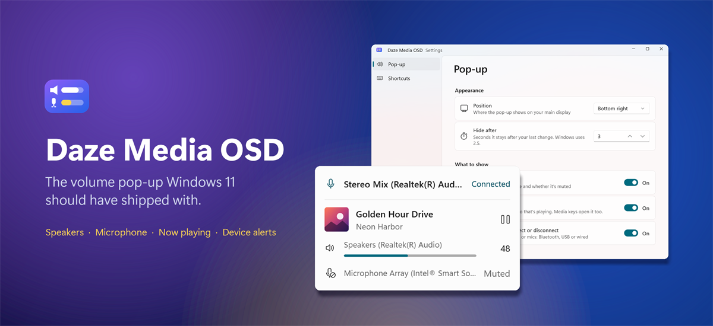
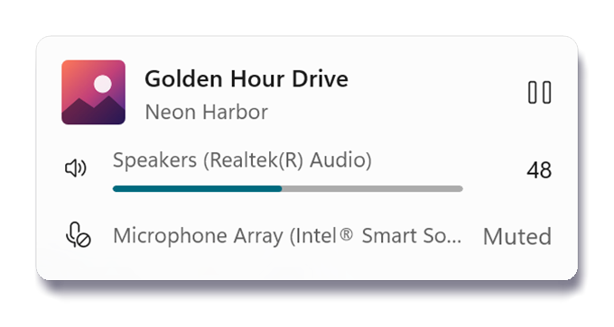
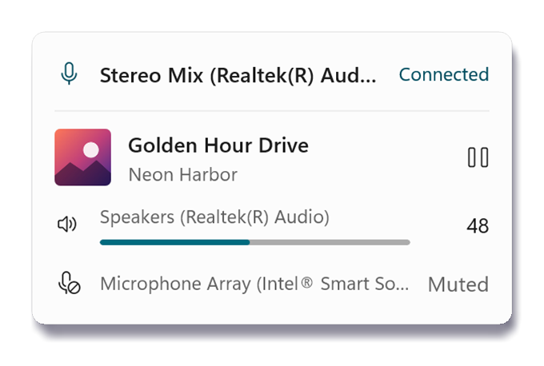
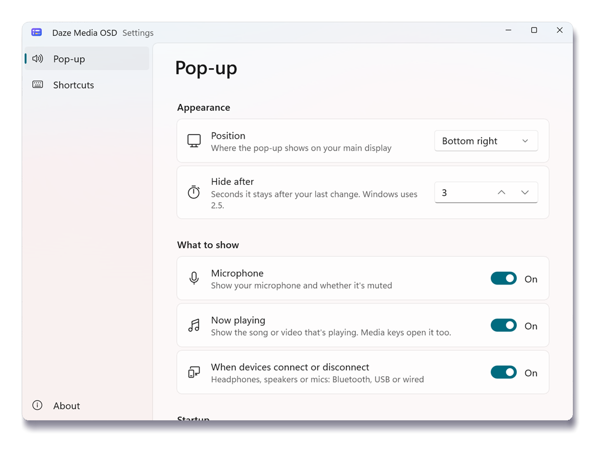
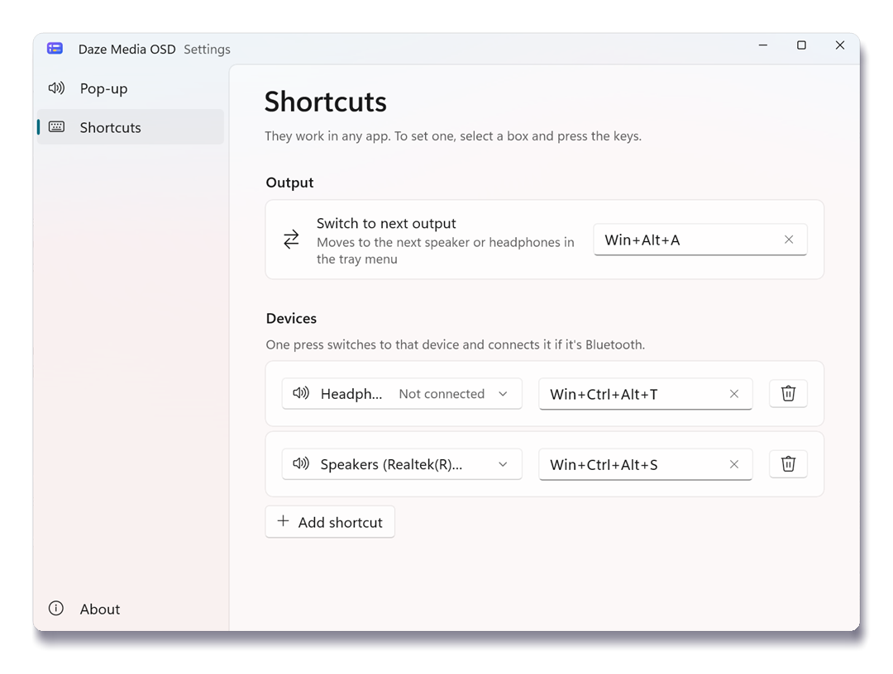

<p align="center">
  
</p>

<p align="center">
  
  
  
  
  
  
</p>

<h3 align="center">Press a volume key. See everything.</h3>

<p align="center">
Windows tells you the volume and nothing else. <b>Daze Media OSD</b> replaces that pop-up with one that also
shows <b>which speaker or headphones</b> you're on, <b>whether your mic is muted</b>, <b>what's playing</b>,
and <b>which device just connected</b>. It looks like part of Windows 11, and it never gets in your way.
</p>

---

## The pop-up

<table>
  <tr>
    <td width="50%" align="center"></td>
    <td width="50%" align="center"></td>
  </tr>
  <tr>
    <td align="center"><b>Every press, the full picture</b><br>Track and cover art, your output with its level, your mic and its mute state.</td>
    <td align="center"><b>Devices announce themselves</b><br>Plug in, pair or switch on, and the pop-up tells you what came and went.</td>
  </tr>
</table>

## Why you'll keep it

|  |  |
|---|---|
| 🎧 **Know where the sound goes** | Speakers, headphones or headset: the pop-up names the device and shows its type. |
| 🎙️ **No more talking on mute** | Your microphone and its mute state are right under the volume. |
| 🎵 **Now playing** | Song, artist and cover from players that share them with Windows, such as your browser or Telegram. Media keys bring it up too. |
| 🔔 **Device alerts** | Bluetooth, USB or wired: see what connected or disconnected, once, with no noise. |
| ⌨️ **A shortcut for every device** | `Win+Alt+A` steps through your outputs. Give each device its own keys: one press switches to it, and if it's Bluetooth headphones that are off, it connects them first. |
| 🖱️ **Switch from the tray** | Right-click the tray icon to pick your output or input. |
| 🛞 **Scroll the taskbar** | Turn the mouse wheel over the taskbar to change the volume. Pick where: anywhere, over your apps or over the tray, and optionally a key to hold. On a laptop the same wheel can also dim and brighten the built-in screen: off until you turn it on in Settings, and never below 5 %. |
| ✨ **Feels native** | Acrylic glass, rounded corners, smooth fade and slide, and it follows your theme and "Animation effects". |
| 🛡️ **Safe by design** | It never steals focus from your game or call, needs no admin rights and doesn't inject into Windows. If it quits or crashes, Windows' own pop-up comes straight back. |

## Settings that stay out of your way

<table>
  <tr>
    <td width="50%" align="center"></td>
    <td width="50%" align="center"></td>
  </tr>
  <tr>
    <td align="center"><b>Pick where it shows and what's on it</b><br>Every change previews live and saves instantly.</td>
    <td align="center"><b>Record a shortcut by pressing it</b><br>Clashes are caught before they bite.</td>
  </tr>
</table>

## Get it running

You need Windows 11 24H2 or later. Download `DazeMediaOsdApp-win-Setup.exe` from
[Releases](https://github.com/dazewell/daze-media-osd/releases) and run it: it installs for your user only, no
admin. It isn't signed yet, so Windows SmartScreen may ask you to confirm ("More info" → "Run anyway").
It checks for updates once a day and installs them the next time it starts
(Settings → About shows the status). Uninstall from Settings → Apps.

To build it yourself, you need the [.NET 10 SDK](https://dotnet.microsoft.com/download/dotnet/10.0)
(`winget install Microsoft.DotNet.SDK.10`).

```powershell
pwsh scripts/install.ps1   # build the installer, install to %LOCALAPPDATA%\DazeMediaOsdApp, then start it
```

The icon appears in the tray (pin it from the `^` overflow). Click it for settings, and turn on
**Start with Windows** there. For development, `pwsh scripts/run.ps1` builds and runs a Debug copy (`-Test`
runs the tests too).

## Status

**0.7.0**, used every day on the author's machine. What's done and what's next:
[docs/GOALS.md](docs/GOALS.md).

## Under the hood

C# / .NET 10, WinUI 3 (Windows App SDK 2.x), unpackaged and self-contained. Core Audio, raw input, WMI and
Global System Media Transport Controls are reached through CsWin32 and CsWinRT.

- Design: [docs/ARCHITECTURE.md](docs/ARCHITECTURE.md)
- Why it's built this way: [docs/DECISIONS.md](docs/DECISIONS.md)
- What didn't work: [docs/DEADENDS.md](docs/DEADENDS.md)
- Building: [.claude/skills/build/SKILL.md](.claude/skills/build/SKILL.md)

## License

[GPL-3.0-or-later](LICENSE). Use it, change it, share it, even sell it. If you hand out a changed version,
you hand out its source code too, under the same license.

Additional permission under GNU GPL version 3 section 7: if you modify this program, or any covered work,
by linking or combining it with the Windows App SDK (or a modified version of it), containing parts covered
by the terms of the Microsoft Software License Terms for the Windows App SDK, the licensors of this program
grant you additional permission to convey the resulting work.

<sub>Written entirely by AI agents. The repo is their memory, and [CLAUDE.md](CLAUDE.md) is where they start.</sub>
