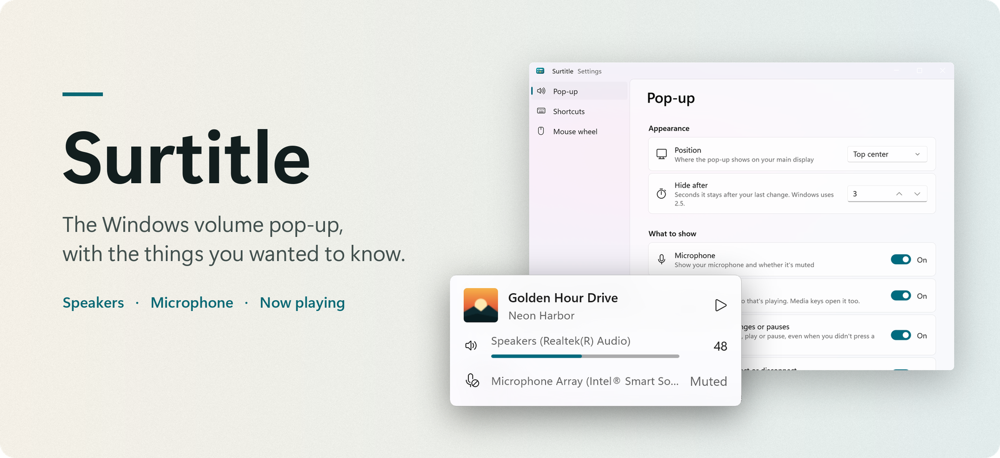
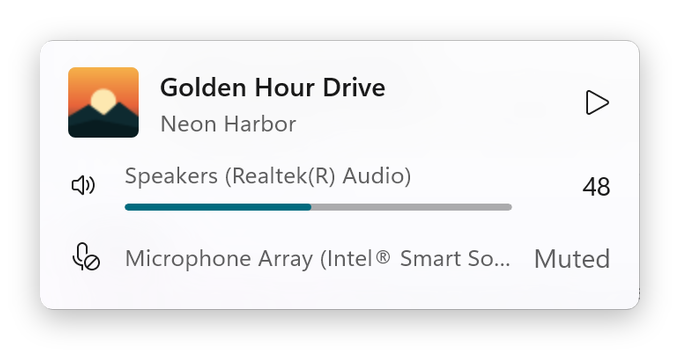
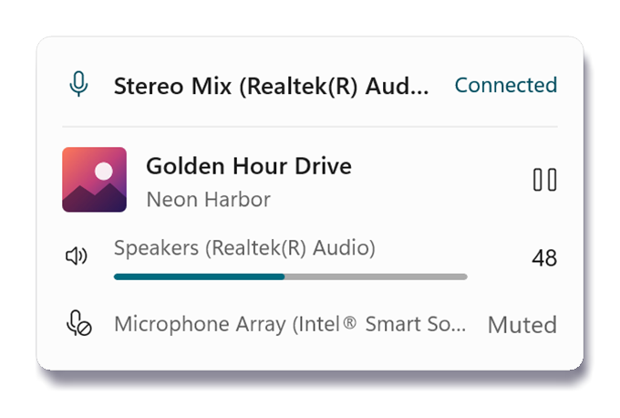
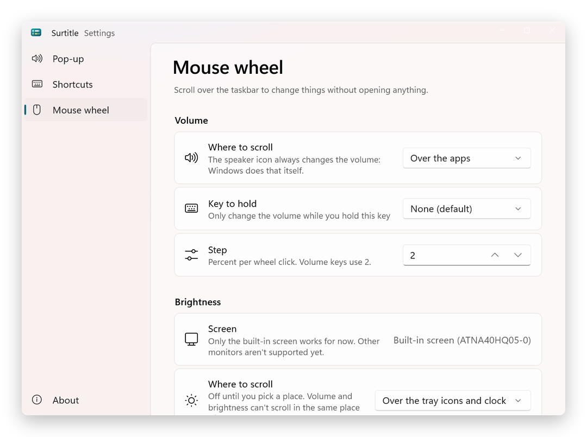
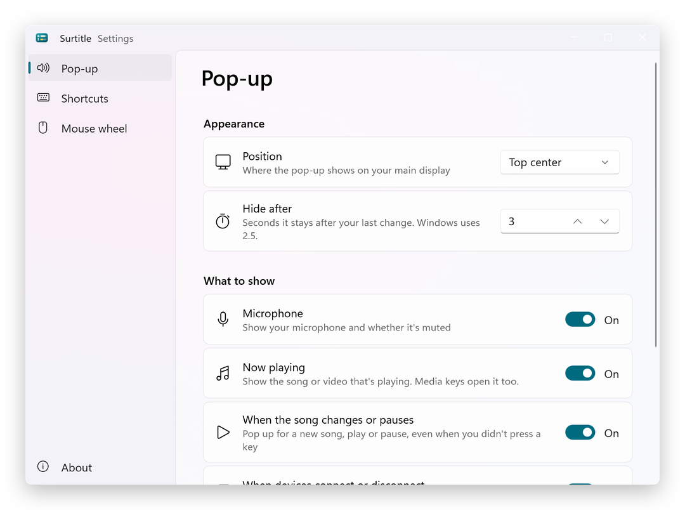
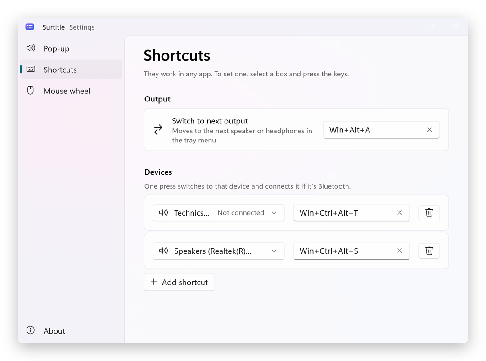

<p align="center">
  <picture><source media="(prefers-color-scheme: dark)" srcset="docs/images/hero-dark.png"></picture>
</p>

<h1 align="center">Surtitle</h1>

<p align="center">The Windows volume pop-up, with the things you wanted to know.</p>

<p align="center">
  
  
  
</p>

In an opera house, surtitles are the lines of text above the stage that tell you what's going on. Surtitle
does the same for the sound on your PC.

Press a volume key and Windows shows you a bar and a number. Surtitle shows its own pop-up in that spot, with
the volume plus the answers to the questions you usually have at that moment: is the sound going to the
speakers or the headphones, is my microphone muted, and what is this song?

## What it looks like

<table>
  <tr>
    <td width="50%" align="center"><picture><source media="(prefers-color-scheme: dark)" srcset="docs/images/popup-media-dark.png"></picture></td>
    <td width="50%" align="center"></td>
  </tr>
  <tr>
    <td align="center">The song and its cover, your speakers and their level, your microphone and whether it's muted.</td>
    <td align="center">When headphones or another device connect or disconnect, the pop-up tells you which one.</td>
  </tr>
</table>

## What it does

- **Shows where the sound goes.** The pop-up names your speakers, headphones or headset, with an icon for each kind.
- **Shows your microphone.** Its name and whether it's muted sit right under the volume, so you notice before you start talking.
- **Shows what's playing.** Song, artist and cover, from any player that shares them with Windows (browsers, Spotify, Telegram and others). The play, pause and skip keys bring the pop-up up too.
- **Tells you when devices come and go.** Bluetooth, USB or wired: one short line when something connects or disconnects.
- **Switches devices from the keyboard.** `Win+Alt+A` moves to your next output. You can also give each device its own shortcut. If that device is a pair of Bluetooth headphones that isn't connected, the shortcut connects it first.
- **Switches devices from the tray.** Right-click the tray icon and pick an output or input.
- **Turns the taskbar into a volume and brightness dial.** Put the mouse over the taskbar and turn the wheel. [More below.](#scroll-the-taskbar)
- **Says why it showed up.** If a call or an app changed something without you pressing a key, the pop-up says so.

It looks like the rest of Windows 11, follows your light or dark theme, and disappears after a couple of seconds.

## Scroll the taskbar

Put the mouse over the taskbar and turn the wheel: the volume changes, and the pop-up shows the new level. You
don't have to open or click anything, and the window you're working in stays in front.

<p align="center">
  <picture><source media="(prefers-color-scheme: dark)" srcset="docs/images/settings-wheel-dark.png"></picture>
</p>

The taskbar has two zones, and each can do something different:

- **Over the apps**: the Start button and your app icons.
- **Over the tray icons and clock**: the corner with the clock.

The setup in the picture uses both: scroll over the apps for volume, scroll over the clock for screen brightness.
If you'd rather have one thing everywhere, pick **Anywhere on the taskbar**.

- **A key to hold.** Each action can ask for Ctrl, Shift or Alt. That way plain scrolling can change the volume and
  Ctrl + scrolling the brightness, in the same place. It also stops accidental changes if you scroll over the taskbar a lot.
- **Step.** How much one click of the wheel changes, in percent.
- **Volume** works out of the box: anywhere on the taskbar, no key, 2 % per click.
- **Brightness** is off until you choose where it scrolls. It works on a laptop's built-in screen and never goes
  below 5 %, so the screen can't go black.

All of it is on the **Mouse wheel** page of the settings.

## Settings

<table>
  <tr>
    <td width="50%" align="center"><picture><source media="(prefers-color-scheme: dark)" srcset="docs/images/settings-popup-dark.png"></picture></td>
    <td width="50%" align="center"><picture><source media="(prefers-color-scheme: dark)" srcset="docs/images/settings-shortcuts-dark.png"></picture></td>
  </tr>
  <tr>
    <td align="center">Choose where the pop-up appears, how long it stays and what's on it. You see each change right away.</td>
    <td align="center">To set a shortcut, press the keys you want. Surtitle tells you if they're already taken.</td>
  </tr>
</table>

## Install

You need Windows 11, version 24H2 or later.

1. Open the [latest release](https://github.com/dazewell/Surtitle/releases/latest), download `Surtitle-…-Setup.exe` (the dots are the version number) and run it.
2. Windows may warn you that it doesn't recognise the app, because it isn't signed yet. Choose "More info", then "Run anyway".
3. Look for the Surtitle icon in the tray, next to the clock. It may be hiding behind the `^` arrow. Click it to open the settings, and turn on **Start with Windows** if you want it there every day.

Surtitle updates itself: it checks once a day and installs the new version the next time it starts. To remove
it, go to Windows Settings → Apps.

## Good to know

- It installs for your user only and never asks for administrator rights.
- It doesn't take over the window you're in, so it won't pull you out of a game or a call.
- If Surtitle is closed or crashes, the normal Windows pop-up comes back by itself.
- It doesn't show over games running in exclusive fullscreen.
- Brightness works on a laptop's built-in screen only, and never goes below 5 %.

## How it's going

Version **0.9.2**. The author uses it every day. What's done and what's planned is in
[docs/GOALS.md](docs/GOALS.md). Found a problem? [Open an issue](https://github.com/dazewell/Surtitle/issues/new);
the About page in the settings has a "Copy details" button that gathers what's useful to include.

## For developers

Surtitle is written in C# on .NET 10 with WinUI 3. The code still uses the project's first name,
`DazeMediaOsd`.

To build it you need the [.NET 10 SDK](https://dotnet.microsoft.com/download/dotnet/10.0)
(`winget install Microsoft.DotNet.SDK.10`).

```powershell
pwsh scripts/run.ps1       # build and run a Debug copy; add -Test to run the tests too
pwsh scripts/install.ps1   # build the installer, install it for your user and start it
```

- How it's built: [docs/ARCHITECTURE.md](docs/ARCHITECTURE.md)
- Why it's built this way: [docs/DECISIONS.md](docs/DECISIONS.md)
- What was tried and didn't work: [docs/DEADENDS.md](docs/DEADENDS.md)
- Build details and troubleshooting: [.claude/skills/build/SKILL.md](.claude/skills/build/SKILL.md)

All of the code is written by AI agents, with a person deciding what gets built. The agents keep their notes in
this repository, starting from [CLAUDE.md](CLAUDE.md).

## License

[GPL-3.0-or-later](LICENSE). Use it, change it, share it, even sell it. If you hand out a changed version,
you hand out its source code too, under the same license.

Additional permission under GNU GPL version 3 section 7: if you modify this program, or any covered work,
by linking or combining it with the Windows App SDK (or a modified version of it), containing parts covered
by the terms of the Microsoft Software License Terms for the Windows App SDK, the licensors of this program
grant you additional permission to convey the resulting work.
